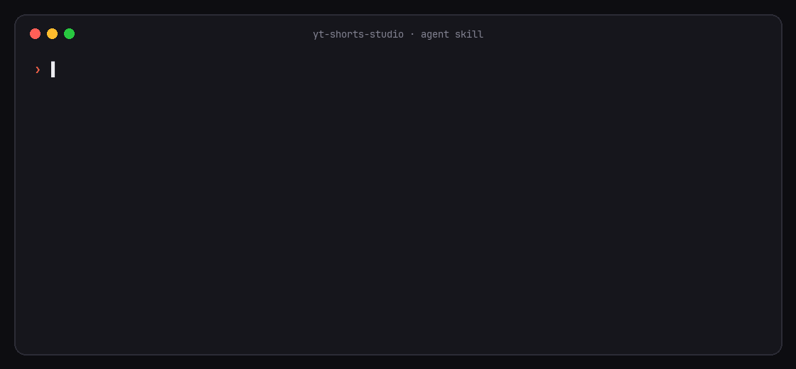

<div align="center">


<h1>yt-shorts-studio</h1>

<p><b>Turn any YouTube video into scroll-stopping Shorts, Reels and TikToks, with one prompt to your AI agent.</b></p>

<p>
  
  
  
  
  
  
</p>

<p>
  <a href="#-install">Install</a> ·
  <a href="#-how-it-works">How it works</a> ·
  <a href="#-layouts">Layouts</a> ·
  <a href="#-filmcraft-live-editing">FilmCraft</a> ·
  <a href="#-whats-inside">What's inside</a>
</p>



</div>

---

Gameplay with a facecam, a two-person podcast, an interview, a vlog or a tutorial: paste the link and say *"make shorts from this"*. The agent reads the **whole transcript**, finds the moments with a real hook and payoff, shows you a ranked list, and after you approve it **downloads only those segments**. It reframes them to 9:16 without cutting anyone out, adds **word-by-word highlighted captions**, builds an **editable timeline** (live in FilmCraft, or with ffmpeg), exports at the resolution you want, and writes the **thumbnails, titles, descriptions, tags and upload checklist**.

Everything runs locally with yt-dlp, ffmpeg and OpenCV. There are no per-minute fees or cloud uploads.

## ✨ Highlights

<table>
<tr>
<td width="50%" valign="top">

**🎯 Moment finding**
- Reads the full word-timed transcript (creator captions first, then auto captions, then Whisper)
- Uses YouTube's *most replayed* peaks
- Clips start on a hook and end on the payoff, snapped to sentence boundaries
- Ranked top picks and backups, then **it stops for your approval**

</td>
<td width="50%" valign="top">

**🎬 Framing that keeps people in shot**
- Contact sheets and scene-cut detection before any crop decision
- Face tracking with one steady framing per camera shot and a hard reframe on every cut
- Split-screen for gameplay + facecam or two-person podcasts
- Full frame over a blurred background when nothing else fits

</td>
</tr>
<tr>
<td valign="top">

**💬 Captions**
- 2–3 word chunks with the spoken word highlighted
- Soft pop-in animation
- Fillers, laughter and bleeps dropped; misheard names fixed
- Native, editable text in FilmCraft, or burned in with libass

</td>
<td valign="top">

**🚀 Ready to post**
- Designed 1080×1920 covers and 1280×720 thumbnails, with the hook text kept clear of faces
- `publish_metadata.md`: titles, alternates, descriptions, captions, tags, hashtags, pinned comment, alt text
- Step-by-step YouTube Studio and Instagram upload checklists

</td>
</tr>
</table>

## 📦 Install

The skill uses the open **Agent Skills** format: a folder with a `SKILL.md` plus scripts. The installer copies it to every agent it finds on your machine.

```bash
git clone https://github.com/snehangshu2002/yt-shorts-studio.git
cd yt-shorts-studio
./install.sh --deps            # macOS / Linux
```

```powershell
git clone https://github.com/snehangshu2002/yt-shorts-studio.git
cd yt-shorts-studio
.\install.ps1 -Deps            # Windows
```

| Agent | Where the skill goes | Use it |
|---|---|---|
| **Claude Code** | `~/.claude/skills/yt-shorts-studio` | It loads automatically, or call it by name: `/yt-shorts-studio <url>` |
| **OpenAI Codex** | `~/.codex/skills/` and `~/.agents/skills/` | It loads automatically when you ask for shorts or clips |
| **Google Antigravity** | `~/.gemini/config/skills/` (plus the older `~/.gemini/antigravity/skills/`) | It loads automatically, or call it by name: `/yt-shorts-studio` |
| **Any other agent** | `~/.agents/skills/`, or point it at `AGENTS.md` | It follows `SKILL.md` step by step |

Use `--agent claude|codex|antigravity|all` to choose, or `--project <dir>` to install into a single repo (`.agents/skills` + `.claude/skills`). Restart your agent afterwards.

**Requirements:** Python 3.9+, [ffmpeg](https://ffmpeg.org/) on PATH, and `pip install -r requirements.txt` (yt-dlp, numpy, opencv-python, Pillow). Node.js on PATH is optional and helps yt-dlp with YouTube's JS challenges. `faster-whisper` is only needed for videos without captions.

## 🧭 How it works

```text
 1. fetch      metadata + word-timed transcript, no video download
 2. plan       rank moments (hook → payoff, 30–60 s, rewatch peaks), snap to sentences
 ⏸  approve    you choose which clips to make
 3. cut        download ONLY those segments; frame-accurate edit files
 4. frame      contact sheets, scene cuts, face tracking → a layout spec per clip
 5. caption    word-by-word highlighted captions (names fixed, fillers dropped)
 6. edit       FilmCraft live timeline, or the ffmpeg renderer (same framing)
 ⏸  preview    you review; changes are cheap
 7. export     any size and fps (1080×1920 at 60 fps, 4K…)
 8. publish    covers, thumbnails, titles, descriptions, tags + upload checklist
```

Example prompts:

> *"https://youtu.be/… make youtube shorts + reels from this, 30–60 s each, show me the moments first"*
> *"cut this podcast into reels, keep both people in frame, 1080p 60 fps"*
> *"give me titles, descriptions and thumbnails for the clips you made"*

## 🖼 Layouts

| Content | Layout | What you get |
|---|---|---|
| Gameplay + facecam | `split` | Gameplay on top with keyframed reframing, the creators below, a gradient seam with captions on it |
| Two people in one shot | `split` | One speaker per panel |
| Camera cuts / single speaker / vlog | `crop` | Face-tracked 9:16 window that jumps on cuts and glides within a shot |
| Screen recording, slides, wide shots | `fit` | The whole frame over a blurred fill, or a zoomed crop on the action |

Each clip is described by a small JSON spec in source pixels, so the same spec renders identically in FilmCraft or ffmpeg at any output size.

## 🎛 FilmCraft live editing

With FilmCraft installed, the skill builds a **real, editable timeline in your open FilmCraft window**: tracks, Motion keyframes, crop, blur, gradients, and every caption as a native text clip. That lets you tweak anything by hand before exporting.

```bash
python skills/yt-shorts-studio/scripts/fc.py setup     # token + launcher (+ Claude Code MCP entry)
python skills/yt-shorts-studio/scripts/fc.py launch    # start FilmCraft with the control bridge
python skills/yt-shorts-studio/scripts/fc.py status
```

No FilmCraft? The ffmpeg renderer produces the same framing and captions automatically.

## 📁 What's inside

```text
skills/yt-shorts-studio/
├── SKILL.md                    the workflow the agent follows
├── references/
│   ├── content-types.md        picking moments and layouts per video type
│   ├── filmcraft.md            live-bridge setup, commands, quirks
│   └── publishing.md           thumbnails, titles, descriptions, upload checklists
├── scripts/
│   ├── fetch_source.py         metadata + transcript + rewatch peaks (no video)
│   ├── transcribe.py           faster-whisper fallback
│   ├── snap_clips.py           snap picks to sentence boundaries, check lengths
│   ├── download_segments.py    approved segments only, aligned + frame-accurate
│   ├── analyze_frames.py       contact sheets, scene cuts, face-tracked crop keys
│   ├── captions.py             word-by-word captions (ASS + JSON)
│   ├── layout.py               shared framing maths
│   ├── build_filmcraft.py      editable timeline in the live FilmCraft app
│   ├── render_ffmpeg.py        same edit without an editor; --still for covers
│   ├── thumbnail.py            designed covers / thumbnails
│   └── fc.py                   FilmCraft bridge helper
└── evals/                      test prompts + graders
AGENTS.md / GEMINI.md           instructions for agents without a skill system
install.sh / install.ps1        installers
```

## ⚖️ Responsible use

Clipping someone else's video means using their content. Credit and link the original in every post (the generated descriptions do this). Reposting without permission can lead to Content ID claims or takedowns. Never present the clips as your own footage.

<div align="center">
<sub>Made with ❤️ for creators and clippers · MIT licensed</sub>
</div>
